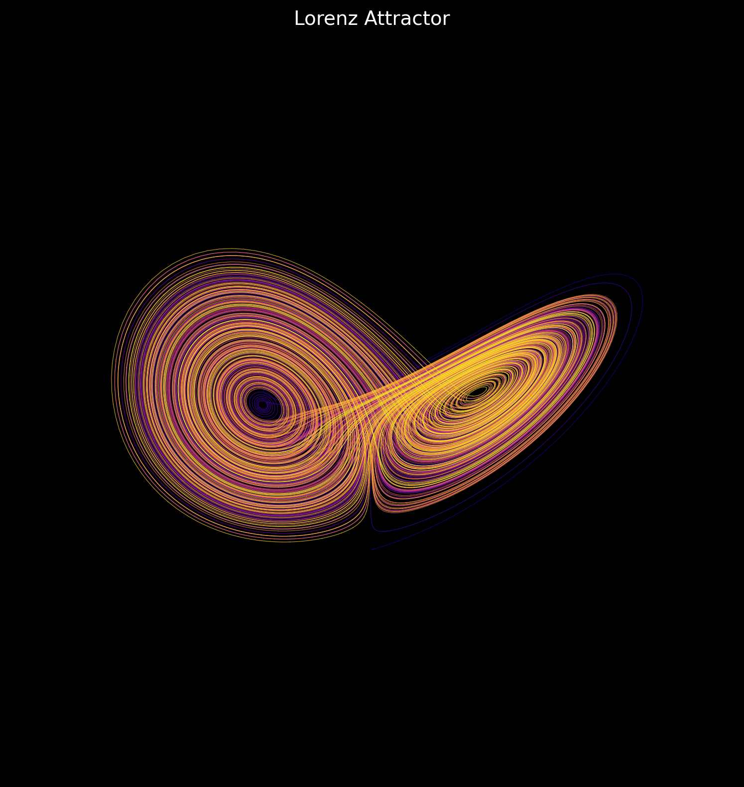
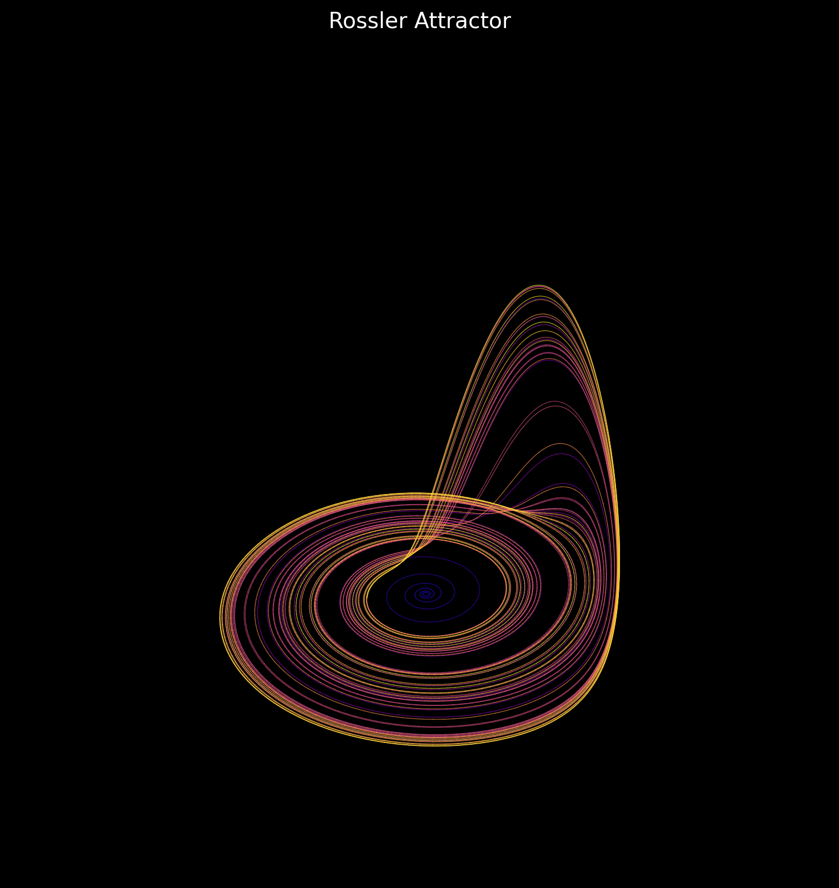
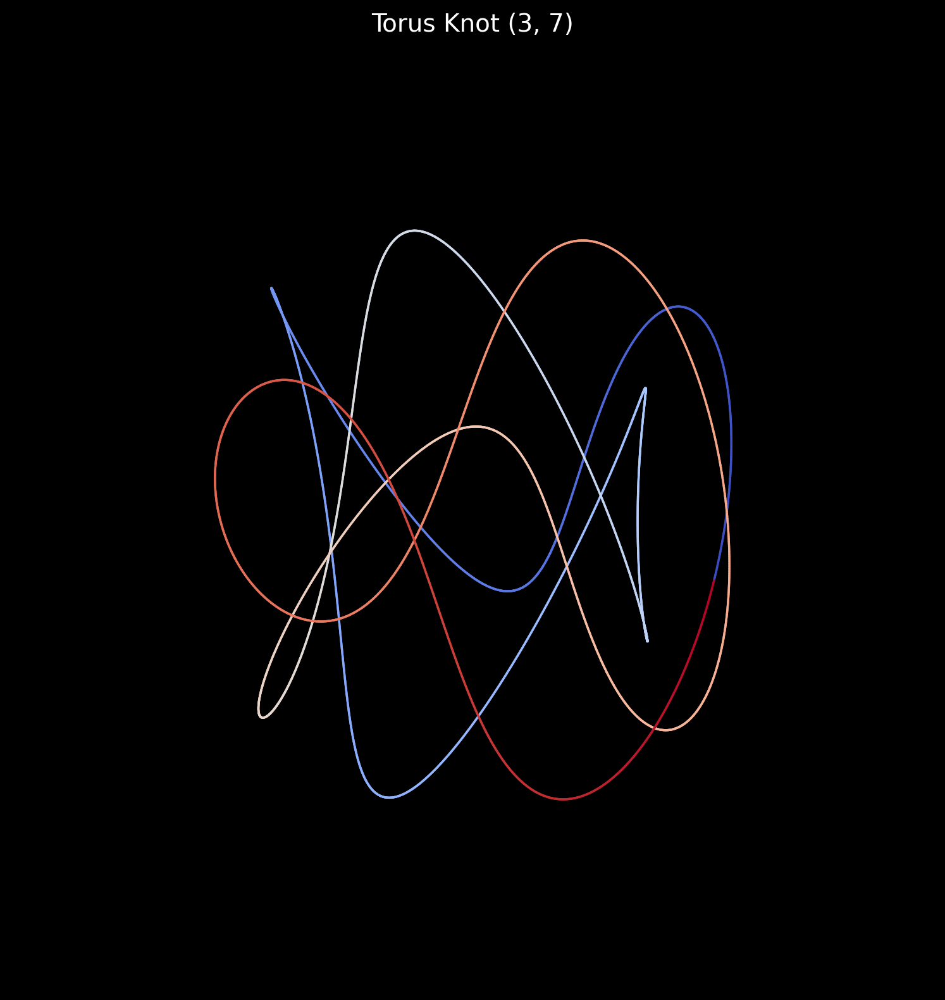
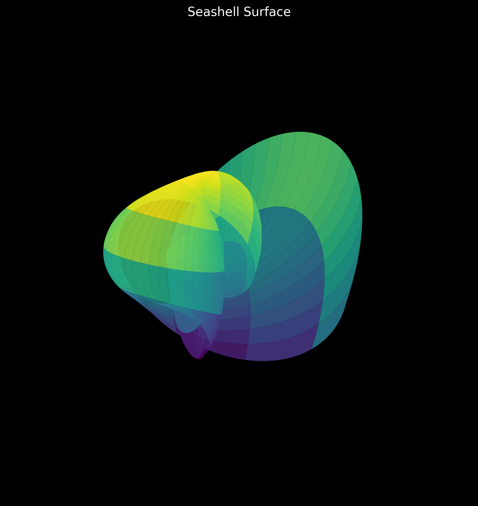

# mathsculpt

**Equations as objects.**

A small gallery of mathematical forms: chaotic trajectories, a parametric knot, and a surface inspired by the geometry of a shell. Each image starts with a few equations and becomes a three-dimensional sculpture through color, perspective, and motion.

[**Explore the interactive attractor →**](https://hakvinv.github.io/mathsculpt/)

## Gallery

<table>
  <tr>
    <td align="center" width="50%">
      <br>
      <strong>Lorenz attractor</strong><br>
      A trajectory folding through a chaotic system. Change the starting conditions and the path evolves differently.
    </td>
    <td align="center" width="50%">
      <br>
      <strong>Rössler attractor</strong><br>
      A looping trajectory generated by three coupled differential equations.
    </td>
  </tr>
  <tr>
    <td align="center" width="50%">
      <br>
      <strong>Torus knot (3, 7)</strong><br>
      A closed curve winding around a torus in two directions.
    </td>
    <td align="center" width="50%">
      <br>
      <strong>Seashell surface</strong><br>
      A spiraling parametric surface with adjustable growth and flare.
    </td>
  </tr>
</table>

## Make your own

```sh
git clone https://github.com/hakvinv/mathsculpt.git
cd mathsculpt
python -m venv .venv
source .venv/bin/activate
pip install numpy matplotlib
python torus_knot.py
```

The scripts write an image to the working directory and open a Matplotlib window. Change the parameters near the top of each file to make a new shape:

| Script | Try changing |
|---|---|
| [`torus_knot.py`](torus_knot.py) | The two winding counts, radii, and color map |
| [`seashell.py`](seashell.py) | Number of turns, height, flare, and opening width |
| [`strange_attractor.py`](strange_attractor.py) | Lorenz or Rössler system, parameters, step size, and color map |

The web explorer is a separate interactive visualization in [`index.html`](index.html). It includes Lorenz, Rössler, and Halvorsen systems.

---

For more work on mathematical models and research, visit [H. Vosteen Research](https://hakvinv.github.io/H.Vosteen-Research-/).
